<!--
  Before committing: search for "EDIT" and fill in each one.
  Anything inside these comment tags is hidden on your profile, so the
  optional sections below stay invisible until you uncomment them.
-->

  

<!-- EDIT: your real name -->
<h1 align="center">Hi, I'm Adrian</h1>

  <!-- EDIT: check your university and year -->
  <b>Computer Science student at the University of Warwick</b> 
  I like turning real-world systems into software: air traffic, chess and game worlds.  
  <!-- EDIT: the roles and dates you're applying for -->
  🔍 <b>Open to software engineering internships for summer 2027</b>

  <!-- EDIT: your LinkedIn URL -->
  
  <!-- EDIT: your email address (keep the mailto: part) -->
  
  
  <!-- Optional: link a PDF of your CV (e.g. upload it to this repo and link to it)
  
  -->

---

## About me

- ✈️ I enjoy building software that models real systems. My **[airport simulator](https://github.com/tgh9000/Airport-modelling-Project-)** runs configurable air traffic scenarios and presents the results through detailed graphs.
- 📈 I'm building a stock exchange matching engine that matches buy and sell orders using price-time priority, supports limit, market, stop and iceberg orders, and is designed around low-latency data structures for the order book.
- 📈 For my third-year project, I'm fine-tuning large language models to predict stock volatility from earnings call transcripts, and testing whether they pick up on what executives actually say or just recognise which company is speaking.
- ♟️ I wrote a **[chess engine](https://github.com/tgh9000/chess-engine-compeititon)** for a competition, and I enjoy the algorithms side of CS: search, data structures and making things fast.
- 🧠 I'm comfortable across paradigms, from object-oriented Java and Python to functional Haskell and C# in Unity.
- 🎮 I've been making games since my A levels, starting with a **[2D platformer](https://github.com/tgh9000/2D-platformer)** in Unity.

<!-- EDIT (optional): uncomment and fill in
- 🌱 Currently learning: ...
- 🤝 Outside of code: societies, sport, hobbies ...
-->

## Tech stack

**Languages** 

**Tools** 

<!-- Uncomment any of these you've genuinely used:

-->

## Featured projects

<table>
  <tr>
    <td width="50%" valign="top">
      <h3>✈️ <a href="https://github.com/tgh9000/Airport-modelling-Project-">Airport Simulation</a></h3>
      
Simulates air traffic through an airport using settings the user configures, then presents the simulated data through in-depth graphs.

      <!-- Optional: a short demo GIF here impresses recruiters more than any description.
      
      -->
      
    </td>
    <td width="50%" valign="top">
      <h3>♟️ <a href="https://github.com/tgh9000/chess-engine-compeititon">Chess Engine</a></h3>
      <!-- EDIT: add how it works (e.g. minimax with alpha-beta pruning) and how it placed -->
      
My entry to a chess engine competition: an engine that searches and evaluates positions to choose its moves.

      
    </td>
  </tr>
  <tr>
    <td width="50%" valign="top">
      <h3>📚 <a href="https://github.com/tgh9000/Warwick-Plus">Warwick Plus</a></h3>
      <!-- EDIT: name the data structures or algorithms you implemented -->
      
My Data Structures and Algorithms project, built in Java.

      
    </td>
    <td width="50%" valign="top">
      <h3>🧩 <a href="https://github.com/tgh9000/Gridlock">Gridlock</a></h3>
      <!-- EDIT: one line on what Gridlock is -->
      
A first-year university project written in Haskell, built in a purely functional style.

      
    </td>
  </tr>
  <tr>
    <td width="50%" valign="top">
      <h3>🎮 <a href="https://github.com/tgh9000/2D-platformer">2D Platformer</a></h3>
      
My A level project: a 2D platformer game built in Unity.

      
      
    </td>
    <td width="50%" valign="top">
      <h3>💬 <a href="https://github.com/tgh9000/Social-Media-platform">Social Media Platform</a></h3>
      <!-- EDIT: what users can do on it (posts, follows, feeds...) -->
      
A social media platform built in Python.

      
    </td>
  </tr>
</table>

<!-- Optional: uncomment once you have things to list
## Highlights

- 🏆 Hackathons, competitions or awards
- 💼 Internships or work experience
- 🎓 Societies, ambassador roles or volunteering
-->

## GitHub stats

  
  

  

